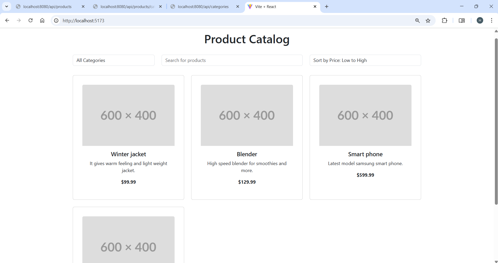
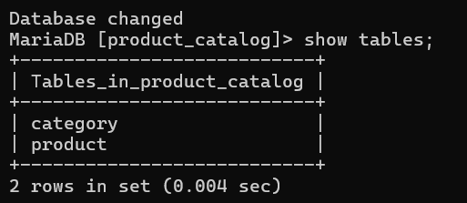
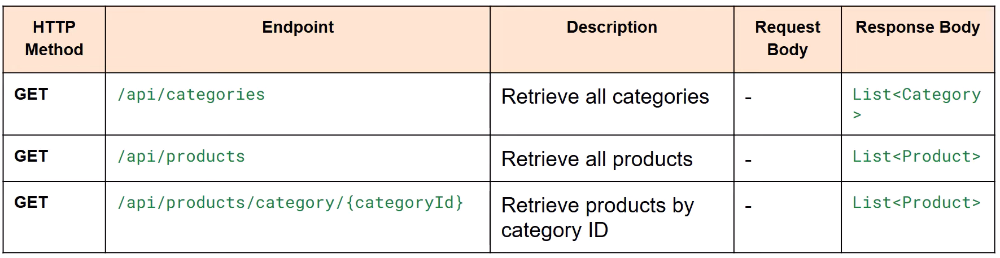

# E-commerce SpringBoot Project

This is a simple E-commerce application built with **Spring Boot**. The project comprises a front-end product catalog and a back-end database for managing products.

---

## Features
- **User-friendly Product Catalog**: A dynamic catalog of products with images, descriptions, and prices.
- **Back-End Database**: A robust database to manage product inventory and categories.
- **RESTful API**: A Spring Boot-based API to interact with the front-end and handle business logic.
- **Paginated product list**: `GET /api/products` returns a page of products in a paged envelope.

---

## Pagination

`GET /api/products` accepts optional query parameters:

| Parameter | Default | Rules |
|---|---|---|
| `page` | `0` | zero-based, must be `>= 0` |
| `size` | `10` | must be between `1` and `100` |

Invalid or non-numeric values return `400`. A page past the end returns an empty page. Products are ordered by ascending id.

```bash
curl "http://localhost:8080/api/products?page=0&size=10"
```

The response is a paged envelope rather than a bare array. Note that the current React front end (`App.jsx`) still expects a bare array and needs a follow-up change to consume the envelope.

---

## Screenshots

### Product Catalog Website
Below is a screenshot of the developed **E-commerce Website** showcasing the product catalog:



---

### Back-End Database
This screenshot shows the **Back-End Database** structure that supports the application, managing product data and user orders:



---

## API Documentation

The **E-commerce SpringBoot** project provides a set of RESTful API endpoints to manage products and orders. Below is a table that outlines the key API endpoints:

### API Endpoints Table
Here is an image of the API table showing the various endpoints:



The table above shows the various API methods, URL paths, request/response formats, and descriptions.

---

## Technologies Used
- **Backend**: Spring Boot, Java
- **Frontend**: React and Vite
- **Database**: H2 in-memory by default (seeded at startup); MySQL connector available but unused in the default profile
- **Other Tools**: Spring Data JPA, Hibernate

---

## How to Run

No Docker is needed. Java 21 and Node 18+ are required.

1. Clone the repository:
   ```bash
   git clone https://github.com/sdixit07/capstoneproject_claude.git
   cd capstoneproject_claude
   ```

2. Run the backend (API on port 8080, in-memory H2 database):
   ```bash
   cd ecom-project
   ./mvnw spring-boot:run      # mvnw.cmd on Windows
   ```

3. Try the API:
   ```bash
   curl "http://localhost:8080/api/products?page=0&size=10"
   ```

4. Run the tests:
   ```bash
   ./mvnw test                 # backend, from ecom-project/
   cd ../ecom-front/ecom-catalog-react
   npm install
   npm test                    # front-end unit tests
   npm run dev                 # front-end dev server
   ```

---

## License
This project is licensed under the MIT License - see the LICENSE file for details.


